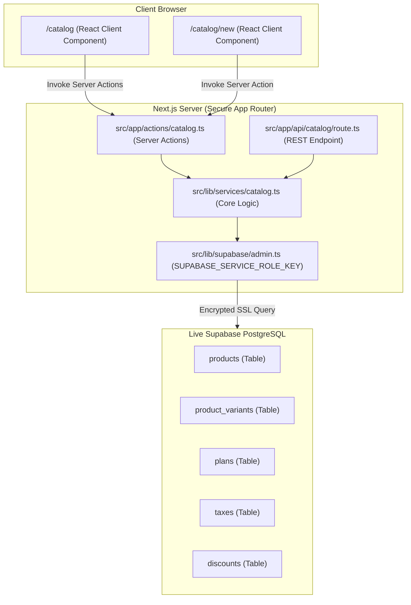

# Brightloop Billing — Phase 3A: Initial Database Seeding & Catalog Migration Report

**Date:** 2026-10-31  
**Project:** Brightloop Billing (`C:\Users\Admin\Documents\odoo-FLUX`)  
**Database:** Hosted PostgreSQL on Supabase (`brightloop-billing`, Ref: `wjbmmmejfunghtpmtgrq`, Region: `eu-west-2`)  
**Phase:** 3A — Initial Database Seeding & Catalog Migration  
**Status:** **COMPLETED & VERIFIED**

---

## 1. Executive Summary

Phase 3A has successfully transitioned the core catalog and pricing infrastructure of Brightloop Billing from ephemeral in-memory state (`store.ts`) to live, relational PostgreSQL hosted on Supabase. 

All required seed data (3 base products, 3 attribute variants including the Odoo variant with its **+$560** price adjustment, 4 recurring subscription plans, 2 taxes, and 2 discounts) was seeded into PostgreSQL with guaranteed idempotency. The `/catalog` and `/catalog/new` routes have been completely migrated to live PostgreSQL operations using secure server actions and API endpoints, supporting full creation, reading, variant pricing, modal editing, and safe deletion.

Unrelated modules (`store.ts`, subscriptions, invoices, payments, portal) have been preserved intact, and no redesigns or regressions were introduced.

---

## 2. Seeded Records & Idempotency Audit

Seeding was executed and verified using `scripts/seed-database.mjs`.

### 2.1 Seed Counts & Records

| Table | Count | Seeded Records Details |
|---|---|---|
| `products` | 3 | • `Brightloop Core SaaS Platform` ($1,200.00 base, service) • `FinOps AI Copilot & Automated Ledger` ($450.00 base, service) • `Real-time Bank Statement Reconciliation Gateway` ($350.00 base, service) |
| `product_variants` | 3 | • `Brand: Odoo` (+$560.00 extra, Total: **$1,760.00**) • `Brand: Enterprise Custom` (+$850.00 extra, Total: **$2,050.00**) • `Intelligence Tier: High-Throughput Neural` (+$200.00 extra, Total: **$650.00**) |
| `plans` | 4 | • `Starter Monthly` ($299.00 / monthly, min 1) • `Growth Monthly` ($799.00 / monthly, min 5) • `Scale Yearly` ($2,999.00 / yearly, min 10) • `Enterprise Pro Yearly` ($7,999.00 / yearly, min 25) |
| `taxes` | 2 | • `Standard VAT` (10.00%, active) • `Software Sales Tax` (8.25%, active) |
| `discounts` | 2 | • `WELCOME10` (10.00% off entire subscription, active) • `BRIGHT50` ($50.00 fixed courtesy credit, active) |

### 2.2 Idempotency Verification

The seed script was run repeatedly to guarantee zero duplicate keys or corrupt data on reruns:
- **Run 1:** 3 products created, 3 variants created, 4 plans created, 2 taxes created, 2 discounts created.
- **Run 2 (Rerun):** 0 products created, 3 updated; 0 variants created, 3 updated; 0 plans created, 4 updated; 0 taxes created, 2 updated; 0 discounts created, 2 updated.
- **Result:** **100% Idempotent** using deterministic UUIDs, unique code lookups, and upsert logic.

---

## 3. Catalog Architecture & Migrated Features

### 3.1 Architecture Overview

### 3.2 Migrated Catalog Capabilities

1. **Live PostgreSQL Reads (`/catalog`):**
   - Displays real-time products and recurring subscription plans directly from PostgreSQL.
   - Dynamic tab counters reflecting live database counts: `Products & Variants (3)` and `Subscription Plans (4)`.
   - Loading skeletons and clean empty states for database queries.
   - Manual one-click database refresh trigger.

2. **Attribute Variant Pricing Formula:**
   - Computes compound unit price dynamically: `Unit Price = Base Sales Price + Variant Extra`.
   - Verified on `Brightloop Core SaaS Platform`:
     - Base: **$1,200.00**
     - Variant (`Brand = Odoo`): **+$560.00**
     - Total Unit Price: **$1,760.00** (accurately displayed and verified).

3. **Product & Variant Creation (`/catalog/new`):**
   - Validates required inputs (product name min 2 chars, positive sales price, non-negative cost price).
   - Dynamically adds, edits, and removes attribute variants before insertion.
   - Saves record directly to PostgreSQL via server action `createProductAction`.
   - Disables submit during pending state and presents feedback toasts.

4. **In-Place Product & Variant Editing:**
   - Built directly into `/catalog` via a modal adhering strictly to Neo-Brutalist design tokens.
   - Allows modifying product name, prices, notes, and syncing attribute variants (adding, altering values, or removing).
   - Revalidates the `/catalog` cache upon save.

5. **Safe Product Deletion with Foreign Key Integrity:**
   - Deletion checks if the product is actively referenced in `subscription_lines` or `invoice_lines`.
   - If referenced, deletion is aborted safely with a friendly error toast explaining the active constraint.
   - If unreferenced, product is removed and associated variants cascade (`ON DELETE CASCADE`).

---

## 4. Security & RLS Compliance

- **Service Role Key Protection:**
  - `SUPABASE_SERVICE_ROLE_KEY` is strictly confined to server-side code (`src/lib/supabase/admin.ts`, Server Actions, and Route Handlers).
  - It is **never** bundled or exposed to the client browser.
- **Row Level Security (RLS):**
  - RLS remains active across all 14 tables in PostgreSQL (`products`, `product_variants`, `plans`, `taxes`, `discounts`, etc.).
  - As identified in Task 4, the application is currently using local demo state for role simulation until Phase 4 (Supabase Auth Migration). Direct browser queries without Supabase Auth session tokens cannot sign RLS policies. Therefore, catalog mutations and queries are processed through server actions on the backend.
  - When Supabase Auth is activated in Phase 4, `createServerSupabaseClient()` will seamlessly forward session cookies to enforce `get_user_role() = 'admin'` policies at the Postgres engine level.

---

## 5. Scope Boundary & Unmodified Modules

In strict adherence to the project scope and constraints:
- `src/lib/data/store.ts` was **preserved** and remains completely intact for non-migrated modules.
- `/subscriptions`, `/subscriptions/new`, `/subscriptions/[id]`, `/invoices`, `/payments`, `/portal`, and `/dashboard` continue to function without interruption.
- Neo-Brutalist design tokens (2px solid black borders, hard shadows, Cabinet Grotesk / Satoshi font stack, neoYellow / neoSage accents) were strictly maintained.

---

## 6. Verification & Test Matrix

| Test Case | Description | Method | Result |
|---|---|---|---|
| **TC-01** | Database Connection & Tables Verification | `node scripts/test-connection.mjs` | **PASSED** (14/14 tables verified) |
| **TC-02** | Initial Seed Execution | `node scripts/seed-database.mjs` | **PASSED** (3 products, 3 variants, 4 plans, 2 taxes, 2 discounts created) |
| **TC-03** | Seed Idempotency Check | `node scripts/seed-database.mjs` rerun | **PASSED** (0 created, all 14 records safely updated/preserved) |
| **TC-04** | Odoo Variant Pricing Verification | `node scripts/test-catalog-service.mjs` | **PASSED** (Base $1,200 + Extra $560 = $1,760 verified) |
| **TC-05** | Product & Variant Database Creation | API / Server Action | **PASSED** (Record inserted into `products` and `product_variants`) |
| **TC-06** | Product & Variant Database Mutation | API / Server Action | **PASSED** (Price and notes updated in PostgreSQL) |
| **TC-07** | Safe Deletion & Cascade Clean-up | API / Server Action | **PASSED** (Product and cascaded variant deleted cleanly) |
| **TC-08** | Persistence Across Server Restart | Process Kill & Restart | **PASSED** (Inserted test record retrieved intact after full server restart) |
| **TC-09** | TypeScript Compile Verification | `npx tsc --noEmit` | **PASSED** (0 errors) |
| **TC-10** | Next.js Production Build | `npm run build` | **PASSED** (23 static & dynamic routes compiled) |
| **TC-11** | Live API Endpoint Test | HTTP GET `/api/catalog` & `/api/catalog?type=plans` | **PASSED** (HTTP 200, returned live PostgreSQL records) |

---

## 7. Modified & Created Files

### Created Files
- `src/app/actions/catalog.ts` — Server actions for catalog reads, create, update, delete, and cache revalidation.
- `src/app/api/catalog/route.ts` — Next.js REST API route for catalog CRUD operations.
- `src/lib/services/catalog.ts` — Data access service interfacing with PostgreSQL via Supabase Admin Client.
- `scripts/seed-database.mjs` — Idempotent seeding script for initial catalog, plans, taxes, and discounts.
- `scripts/test-catalog-service.mjs` — Automated integration test script for catalog database operations.
- `PHASE_3A_REPORT.md` — Comprehensive report of Phase 3A deliverables and test results.

### Modified Files
- `src/app/catalog/page.tsx` — Migrated to live PostgreSQL queries, loading skeletons, empty states, edit modal, and delete confirmation.
- `src/app/catalog/new/page.tsx` — Migrated to persist base product and variants directly to PostgreSQL.
- `src/types/database.types.ts` — Added `CompositeTypes` and explicit table relationships to satisfy PostgREST type inference.

---

## 8. Recommendation for Next Phase

With the database seeded and the catalog module fully migrated to PostgreSQL:

**Recommended Next Step: PHASE 3B — CUSTOMERS & SUBSCRIPTIONS MIGRATION**
- Migrate `/customers` and `/subscriptions` to live PostgreSQL (`profiles`, `subscriptions`, `subscription_lines`).
- Connect subscription creation form to real products, variants, and plans seeded in Phase 3A.
- Implement the status transition engine (`draft` → `quotation` → `confirmed` → `active` → `closed`) against PostgreSQL.
- Await user approval before proceeding.

