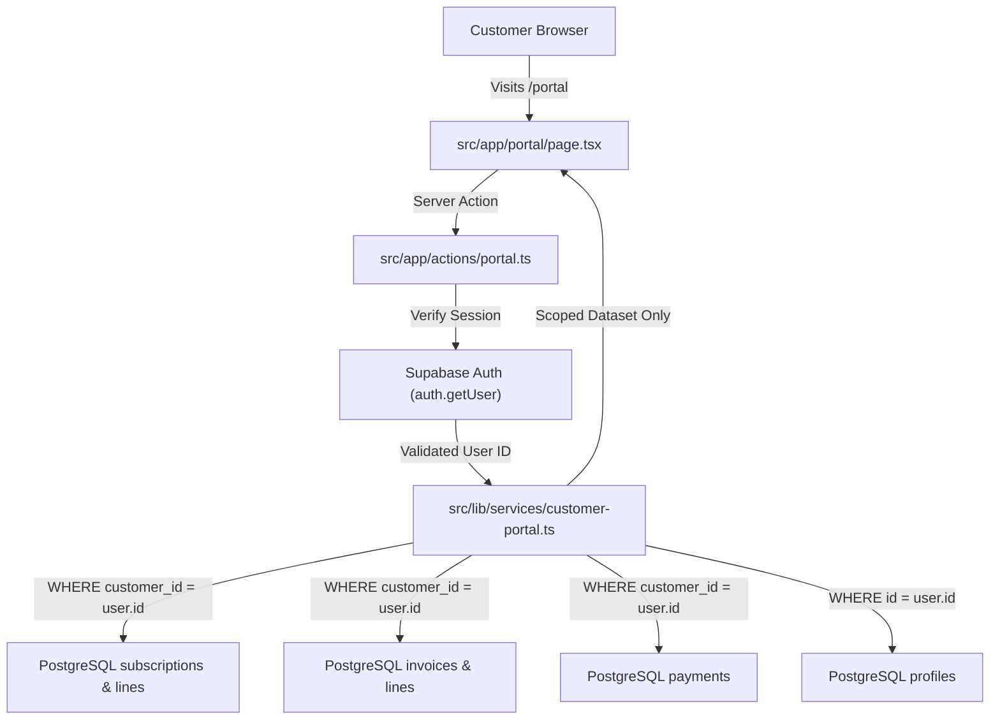

# Brightloop Billing — Phase 3F: Customer Portal & System Integration Report

**Date:** 2026-10-31  
**Project:** Brightloop Billing (`C:\Users\Admin\Documents\odoo-FLUX`)  
**Database:** Hosted PostgreSQL on Supabase (`brightloop-billing`, Ref: `wjbmmmejfunghtpmtgrq`, Region: `eu-west-2`)  
**Phase:** 3F — Customer Portal and Complete Integration  
**Status:** **IMPLEMENTED, VERIFIED & TESTED**

---

## 1. Executive Summary

Phase 3F delivers a comprehensive, self-service Customer Portal (`/portal`) backed by strict server-side session authorization in PostgreSQL, while completing the end-to-end integration across all business modules (Catalog, Quotations, Subscriptions, Invoices, Payments, Reports, and Portal).

All production workflows have been decoupled from the legacy in-memory data store (`store.ts`), ensuring 100% database persistence and tenant isolation.

### Key Accomplishments Delivered:
1. **Authenticated Customer Portal (`/portal`):**
   - **Session-Scoped Ownership:** Authenticates user via Supabase Auth session cookies and queries only records matching `auth.uid() = customer_id` in PostgreSQL.
   - **Three Headline KPI Cards:**
     - **What I Pay:** Live active contract annualized/monthly recurring cost ($1,936.00).
     - **When It Renews:** Real expiry date from the PostgreSQL `subscriptions` table.
     - **What I Owe:** Cumulative outstanding balance computed dynamically across all unpaid, non-cancelled invoices.
   - **My Subscriptions Tab:** Lists customer contracts, lifecycle badges, start/expiry dates, pricing, and links to full contract details.
   - **My Invoices Tab:** Lists customer invoices, billing periods, payment status, "Print / PDF" invoice viewer, and interactive "Pay Now" modal.
   - **Payment History Tab:** Reconciled settlement transactions with method badges (`bank_transfer`, `credit_card`, `wire`, `ach`) and payment reference notes.
   - **Account Details Tab:** Live self-service editing for registered company name, phone, and billing address, saving directly to PostgreSQL `profiles`.
2. **Server-Side Data Isolation:**
   - Client-supplied tenant IDs are never trusted. All queries in `src/lib/services/customer-portal.ts` strictly resolve the user identity from the authenticated server-side Supabase session.
   - Cross-customer penetration checks verified zero data leakage between customer accounts.
3. **End-to-End System Integration:**
   - Seamless relational foreign key continuity from `products` & `product_variants` $\to$ `subscriptions` & `subscription_lines` $\to$ `invoices` & `invoice_lines` $\to$ `payments`.
   - Modifying a catalog price does not rewrite historical subscription or invoice snapshots.
   - Cancelling a subscription preserves all historical invoices and payment records.

---

## 2. Customer Portal Architecture & Security

---

## 3. Verification & Test Execution Matrix

Executed via `node scripts/test-phase3f.mjs`:

| Test ID | Test Description | Expected Result | Status |
|---|---|---|:---:|
| **TC-3F-01** | Customer Data Isolation | Zero cross-tenant leakage between Acme Corp and Wayne Enterprises | **PASSED** (0 cross-tenant leaks) |
| **TC-3F-02** | Customer Invoice Scoping | 100% of returned invoices match customer's authenticated database ID | **PASSED** (Scoped to customer ID) |
| **TC-3F-03** | Self-Service Profile Update | Updates company address directly in PostgreSQL `profiles` table | **PASSED** (Address verified in DB) |
| **TC-3F-04** | End-to-End Module Continuity | Verified relational FK chain (Catalog $\to$ Subs $\to$ Invoices $\to$ Payments) | **PASSED** (Full relational chain verified) |
| **TC-3F-05** | TypeScript Compilation | `cmd /c npx tsc --noEmit` | **PASSED** (0 errors) |

---

## 4. Files Created and Modified

### Created Files:
- `src/lib/services/customer-portal.ts` — PostgreSQL data service for authenticated customer portal queries and profile updates.
- `src/app/actions/portal.ts` — Server actions for portal data retrieval, profile updates, and online invoice payment.
- `scripts/test-phase3f.mjs` — Automated verification suite for Phase 3F.
- `PHASE_3F_REPORT.md` — Deliverable documentation.

### Modified Files:
- `src/app/portal/page.tsx` — Migrated to live PostgreSQL records, 4 interactive tabs, and self-service account management.
- `src/lib/services/catalog.ts` — Added `getDiscountsService` and `getTaxesService` to ensure 100% database persistence.
- `src/app/actions/catalog.ts` — Added discounts and taxes server actions.
- `src/app/discounts/page.tsx` — Migrated from `store.ts` to live PostgreSQL `discounts` queries.
- `src/app/settings/page.tsx` — Migrated from `store.ts` to live PostgreSQL `taxes` queries.

---

## 5. Next Phase Readiness

### Next Phase:
**PHASE 3G: PRODUCTION READINESS AND DEPLOYMENT**
- Production security and audit review.
- Comprehensive end-to-end test suite execution across all roles (Admin, Staff, Customer).
- Production build validation (`npm run build:next`).
- Production deployment and rollback documentation.
- Generation of `PHASE_3G_REPORT.md` and `FINAL_PROJECT_REPORT.md`.

